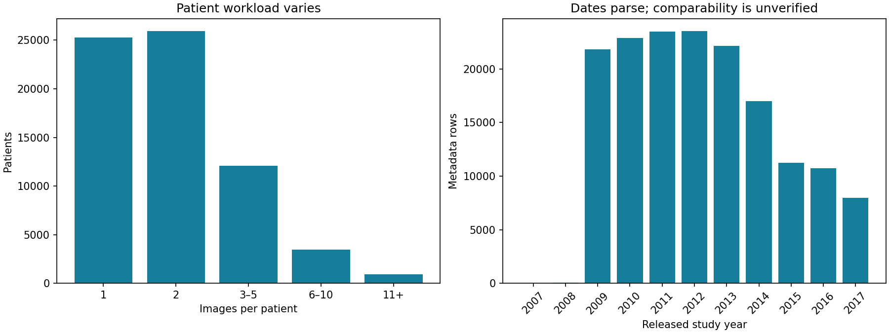

# First PadChest inspection

Run: 2026-10-15. Scope: the downloaded metadata and the single PNG in the local `50.zip`. These are discovery findings, not training or unlearning results. Counts below precede any quality, view or diagnosis filtering.

| Check | Observed result | Meaning for the experiment |
|---|---|---|
| Metadata images / patients | 160,861 / 67,625 | Enough metadata to design a patient cohort; images are not all downloaded. |
| Images per patient | Minimum 1, median 2, maximum 119 | Patient workloads differ substantially. |
| Studies per patient | Minimum 1, median 1, maximum 116 | Keep every selected patient's studies within one data split. |
| Core IDs | No missing patient, image or study IDs | Group using string `PatientID`; the unnamed first column is an exported index. |
| Image identity | No duplicate image IDs or image IDs shared by different patients | No conflicts detected in these identifiers; pixel duplicates were not checked. |
| Patients spanning archives | 21,703 | Archive boundaries do not define patient-complete cohorts. |
| Released study dates | All parse; 2007–2017, including 68 rows before 2009 | Investigate the early rows. Cross-patient date comparability remains unverified. |
| Label provenance | 39,053 physician-labelled rows; 121,808 RNN-labelled rows | Report automatic versus physician annotation separately. |
| Missing label lists | 103 rows | Exclude or otherwise handle explicitly before supervised training. |
| Projection metadata | Derived `Projection` complete; original `ViewPosition_DICOM` missing for 69,085 rows | Choose and document the projection field used for eligibility. |
| Local archive | One PNG; exactly one metadata match | This is a loading preview, not a training cohort. |
| Decoded image | 4,280 × 3,520 pixels; 16-bit unsigned grayscale | Decodes successfully; dimensions agree with metadata. |

## Image inspection and preprocessing

The previewed image's patient has seven metadata images across six archives; only one image was found in the supplied ZIP. The local preview shows the full storage range and a 1st–99th percentile display window. Neither changes the source image. Its diagnosis annotation is automatically assigned and has not been clinically verified here.

The PNG pixel range is 6,216–63,485, while the original DICOM `BitsStored` field says 10. Therefore, do not normalize the PNG using that original DICOM bit-depth tag alone. Inspect the actual decoded representation and specify preprocessing before training. A single successful decode does not validate the complete image collection.

## Decisions before a pilot

1. Select a small cohort by patient and eligible view, then build a local image-to-archive manifest. Obtain all eligible images for those patients; do not treat a ZIP as a complete cohort.
2. Normalize label whitespace and decide how to handle empty label strings, missing lists, exclusions and automatic labels. Raw label-string counts are not a cleaned disease vocabulary.
3. Create patient-disjoint train/validation/test splits, then count eligible **training** images per patient for the workload score.
4. Verify released date semantics before using cross-patient recency. Image count is a workload proxy, not evidence that a patient will withdraw. Evaluate explicitly simulated withdrawal scenarios if actual requests are unavailable.
5. In SISA training order, patients expected to need cheaper deletion should enter **later** slices: deleting an early-slice patient forces more subsequent training to replay. Preserve whole-patient grouping and diagnostic balance.

## Reproducibility

Inputs were copied from Downloads into the ignored local `data/raw/` folder; originals were preserved. The supplied dataset licence restricts redistribution. Raw metadata, images, individual image previews and patient-level manifests are not included in Git. Only inspected aggregate findings and the aggregate chart are published here.

| Input | SHA-256 |
|---|---|
| `PADCHEST_chest_x_ray_images_labels_160K_01.02.19.csv.gz` | `EC49E52AA45609365F6B2F4D269D2E6242E56CA76BAB932DCE61DDB45FB3BADE` |
| `50.zip` | `C4617C239B71C21DC0BCB29EAEF83B94B6F94DBA1865E1ECFD6C3B45E0B7158A` |

Executed with Python 3.13.5, Pillow 11.3.0, NumPy 2.3.1 and Matplotlib 3.10.3. Five synthetic metadata tests passed, including missing-value sentinels, identifier preservation, duplicates, compressed input and malformed rows. Both scripts completed on the supplied files; generated figures were visually inspected. Commands are in the [README](../README.md). No models have been trained yet.
