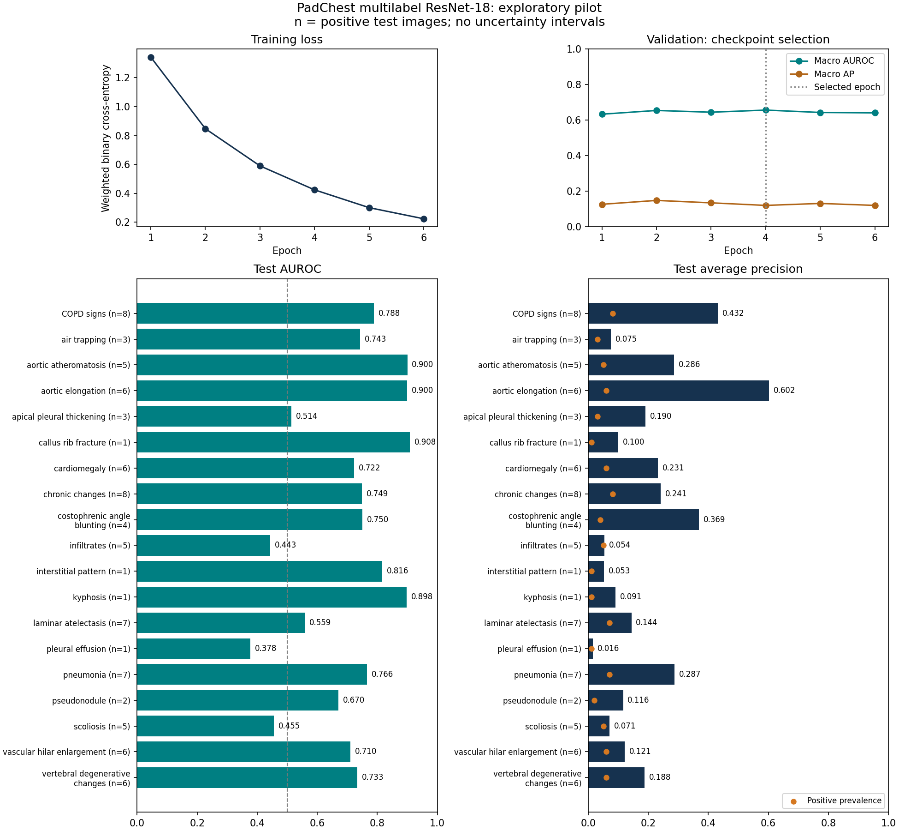

# Multilabel ResNet-18 on PadChest

Full ImageNet-initialized ResNet-18 fine-tuning with **19 independent finding outputs**. Multiple findings can be positive in the same image. The old binary target is not used.

| Setting | Value |
|---|---|
| Input / budget | 224×224, batch 16, 6 epochs |
| Loss / optimizer | Weighted BCEWithLogitsLoss / Adam 0.0001 |
| Selected checkpoint | Epoch 4, highest validation macro AUROC |
| Training time | 229.2 seconds (3.82 minutes) |
| Fit including validation/checkpoints | 251.8 seconds; cached preparation excluded |
| Backbone updated | True |

| Split | Patients | Images | Images with ≥2 selected findings | Macro AUROC | Macro AP | Micro F1 at 0.5 | Valid ranking labels |
|---|---:|---:|---:|---:|---:|---:|---:|
| train | 435 | 459 | 113 | 1.000 | 0.999 | 0.786 | 19/19 |
| validation | 123 | 128 | 25 | 0.657 | 0.121 | 0.176 | 17/19 |
| test | 95 | 99 | 22 | 0.705 | 0.193 | 0.215 | 19/19 |

## Per-finding support and test performance

Vocabulary chosen using training patients only: ≥10 positive and ≥10 negative patients, excluding `normal` and `unchanged`. These are raw recorded finding terms; this is not the entire PadChest label catalogue.

| Finding | Train + patients | Train + images | Val + images | Test + images | Test AUROC | Test AP | Test recall at 0.5 |
|---|---:|---:|---:|---:|---:|---:|---:|
| COPD signs | 49 | 51 | 9 | 8 | 0.788 | 0.432 | 0.625 |
| air trapping | 23 | 24 | 3 | 3 | 0.743 | 0.075 | 0.000 |
| aortic atheromatosis | 14 | 14 | 5 | 5 | 0.900 | 0.286 | 0.000 |
| aortic elongation | 39 | 40 | 9 | 6 | 0.900 | 0.602 | 0.833 |
| apical pleural thickening | 15 | 15 | 4 | 3 | 0.514 | 0.190 | 0.333 |
| callus rib fracture | 10 | 10 | 0 | 1 | 0.908 | 0.100 | 0.000 |
| cardiomegaly | 31 | 32 | 10 | 6 | 0.722 | 0.231 | 0.333 |
| chronic changes | 36 | 37 | 15 | 8 | 0.749 | 0.241 | 0.375 |
| costophrenic angle blunting | 16 | 16 | 5 | 4 | 0.750 | 0.369 | 0.250 |
| infiltrates | 10 | 10 | 2 | 5 | 0.443 | 0.054 | 0.000 |
| interstitial pattern | 14 | 16 | 3 | 1 | 0.816 | 0.053 | 0.000 |
| kyphosis | 11 | 13 | 0 | 1 | 0.898 | 0.091 | 0.000 |
| laminar atelectasis | 10 | 10 | 3 | 7 | 0.559 | 0.144 | 0.143 |
| pleural effusion | 11 | 12 | 3 | 1 | 0.378 | 0.016 | 0.000 |
| pneumonia | 16 | 16 | 5 | 7 | 0.766 | 0.287 | 0.429 |
| pseudonodule | 11 | 11 | 5 | 2 | 0.670 | 0.116 | 0.500 |
| scoliosis | 22 | 24 | 9 | 5 | 0.455 | 0.071 | 0.000 |
| vascular hilar enlargement | 18 | 18 | 5 | 6 | 0.710 | 0.121 | 0.000 |
| vertebral degenerative changes | 25 | 25 | 3 | 6 | 0.733 | 0.188 | 0.167 |

The constant training-prevalence predictor gives test macro AUROC **0.500** and macro AP **0.045**. AP is compared with positive prevalence, not 0.5. Per-label confusion matrices, macro/micro F1, micro ranking metrics, Hamming loss and exact-match accuracy are in the JSON.

Training ranking scores are almost perfect while held-out scores are much lower, indicating substantial overfitting. The fixed-threshold F1 and per-finding recalls also show that useful ranking does not guarantee reliable positive predictions. The current result establishes a working multilabel baseline, not a clinically validated classifier.

**Interpretation limits:** single seed; small archive-based convenience sample; sparse positive support; previously inspected exploratory test cohort; no patient-bootstrap intervals. Missing annotations are treated as zeros, not confirmed clinical absence. Null ranking scores indicate only one observed class and are excluded from macro ranking averages. Scores are image-level. No unlearning has been performed in this run.

[Protocol, loss formula and reproduction commands](../docs/multilabel-training-protocol.md). Checkpoints and individual predictions remain local. The binary experiment is retained as an earlier pipeline check.
