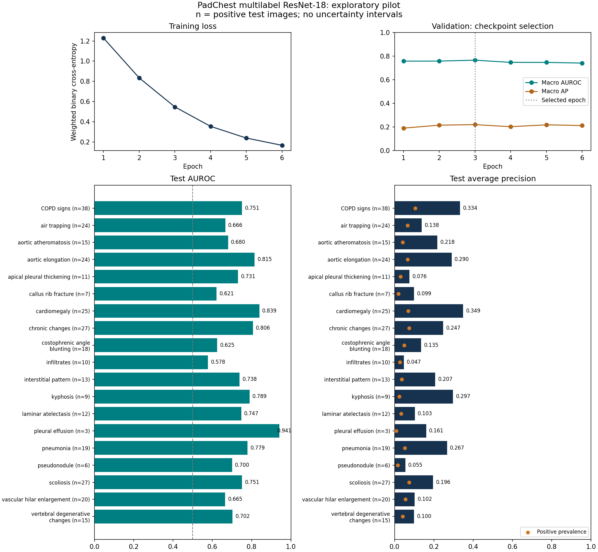

# Multilabel ResNet-18 on PadChest

Full ImageNet-initialized ResNet-18 fine-tuning with **19 independent finding outputs**. Multiple findings can be positive in the same image. The old binary target is not used.

| Setting | Value |
|---|---|
| Input / budget | 224×224, batch 16, 6 epochs |
| Loss / optimizer | Weighted BCEWithLogitsLoss / Adam 0.0001 |
| Selected checkpoint | Epoch 3, highest validation macro AUROC |
| Training time | 787.7 seconds (13.13 minutes) |
| Fit including validation/checkpoints | 857.4 seconds; cached preparation excluded |
| Backbone updated | True |

| Split | Patients | Images | Images with ≥2 selected findings | Macro AUROC | Macro AP | Micro F1 at 0.5 | Valid ranking labels |
|---|---:|---:|---:|---:|---:|---:|---:|
| train | 1586 | 1665 | 384 | 0.994 | 0.939 | 0.425 | 19/19 |
| validation | 386 | 413 | 104 | 0.766 | 0.221 | 0.226 | 19/19 |
| test | 345 | 363 | 85 | 0.733 | 0.180 | 0.201 | 19/19 |

## Per-finding support and test performance

Vocabulary fixed to the earlier pilot's ordered labels; no new findings added as the cohort expands. These are raw recorded finding terms; this is not the entire PadChest label catalogue.

| Finding | Train + patients | Train + images | Val + images | Test + images | Test AUROC | Test AP | Test recall at 0.5 |
|---|---:|---:|---:|---:|---:|---:|---:|
| COPD signs | 174 | 180 | 48 | 38 | 0.751 | 0.334 | 0.579 |
| air trapping | 82 | 84 | 13 | 24 | 0.666 | 0.138 | 0.333 |
| aortic atheromatosis | 56 | 58 | 13 | 15 | 0.680 | 0.218 | 0.400 |
| aortic elongation | 131 | 134 | 26 | 24 | 0.815 | 0.290 | 0.667 |
| apical pleural thickening | 61 | 61 | 17 | 11 | 0.731 | 0.076 | 0.636 |
| callus rib fracture | 31 | 31 | 5 | 7 | 0.621 | 0.099 | 0.143 |
| cardiomegaly | 115 | 124 | 32 | 25 | 0.839 | 0.349 | 0.720 |
| chronic changes | 138 | 139 | 38 | 27 | 0.806 | 0.247 | 0.667 |
| costophrenic angle blunting | 52 | 53 | 16 | 18 | 0.625 | 0.135 | 0.444 |
| infiltrates | 40 | 40 | 18 | 10 | 0.578 | 0.047 | 0.100 |
| interstitial pattern | 47 | 50 | 22 | 13 | 0.738 | 0.207 | 0.385 |
| kyphosis | 45 | 47 | 9 | 9 | 0.789 | 0.297 | 0.556 |
| laminar atelectasis | 31 | 32 | 18 | 12 | 0.747 | 0.103 | 0.500 |
| pleural effusion | 34 | 35 | 15 | 3 | 0.941 | 0.161 | 0.333 |
| pneumonia | 48 | 48 | 21 | 19 | 0.779 | 0.267 | 0.263 |
| pseudonodule | 38 | 38 | 13 | 6 | 0.700 | 0.055 | 0.167 |
| scoliosis | 113 | 119 | 27 | 27 | 0.751 | 0.196 | 0.704 |
| vascular hilar enlargement | 64 | 66 | 11 | 20 | 0.665 | 0.102 | 0.500 |
| vertebral degenerative changes | 86 | 86 | 22 | 15 | 0.702 | 0.100 | 0.467 |

The constant training-prevalence predictor gives test macro AUROC **0.500** and macro AP **0.047**. AP is compared with positive prevalence, not 0.5. Per-label confusion matrices, macro/micro F1, micro ranking metrics, Hamming loss and exact-match accuracy are in the JSON.

Training ranking scores are almost perfect while held-out scores are much lower, indicating substantial overfitting. The fixed-threshold F1 and per-finding recalls also show that useful ranking does not guarantee reliable positive predictions. The current result establishes a working multilabel baseline, not a clinically validated classifier.

**Interpretation limits:** single seed; small archive-based convenience sample; sparse positive support; previously inspected exploratory test cohort; no patient-bootstrap intervals. Missing annotations are treated as zeros, not confirmed clinical absence. Null ranking scores indicate only one observed class and are excluded from macro ranking averages. Scores are image-level. No unlearning has been performed in this run.

[Protocol, loss formula and reproduction commands](../docs/multilabel-training-protocol.md). Checkpoints and individual predictions remain local. The binary experiment is retained as an earlier pipeline check.
