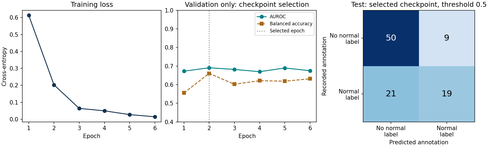

# Conventional ResNet-18: first PadChest run

ImageNet-initialized ResNet-18, all layers fine-tuned on the downloaded archive. This is an exploratory conventional training baseline, with no unlearning.

| Setting | Measured/configured value |
|---|---|
| Patients (train / validation / test) | 435 / 123 / 95 |
| Images (train / validation / test) | 459 / 128 / 99 |
| Input and training | 224×224; batch 16; Adam 0.0001; 6 epochs |
| Selected checkpoint | Epoch 2, highest validation AUROC |
| Training only | 210.1 seconds (3.50 minutes) |
| Fit incl. validation/checkpoint writes | 231.0 seconds |
| Image preparation | 227.9 seconds |
| Backbone updated | True |

| Split | AUROC | Accuracy | Balanced accuracy | Normal-label sensitivity | Normal-label specificity |
|---|---:|---:|---:|---:|---:|
| train | 1.0000 | 0.9913 | 0.9893 | 0.9786 | 1.0000 |
| validation | 0.6909 | 0.7031 | 0.6606 | 0.4510 | 0.8701 |
| test | 0.7284 | 0.6970 | 0.6612 | 0.4750 | 0.8475 |

The decision threshold is fixed at 0.5. The always-negative test baseline has accuracy 59/99 = 59.60% and balanced accuracy 50%. The target is **normal annotation presence**; its absence does not confirm disease.

**Limits:** one seed, small archive-based convenience sample, and an exploratory test split already inspected in the earlier pilot. No confidence interval or clinical generalization claim. The earlier 64×64 TinyCNN SISA run is not a matched model comparison.

[Training protocol and sources](../docs/normal-training-protocol.md). The initial, best and last checkpoints remain local under the run's ignored output directory. Next, train SISA with the same ResNet-18 initialization and preprocessing.
